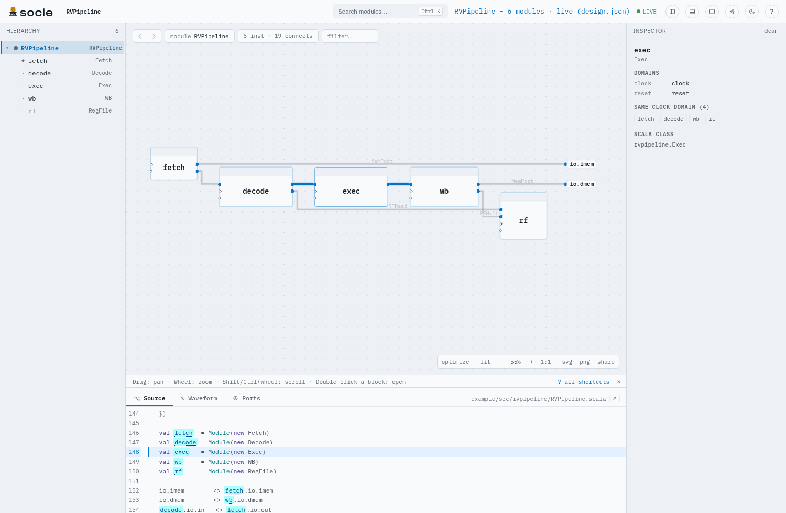
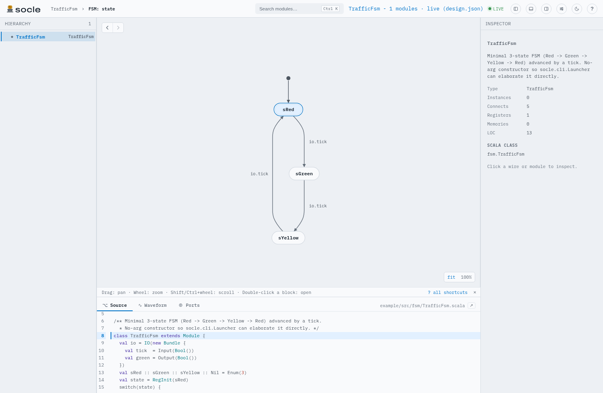
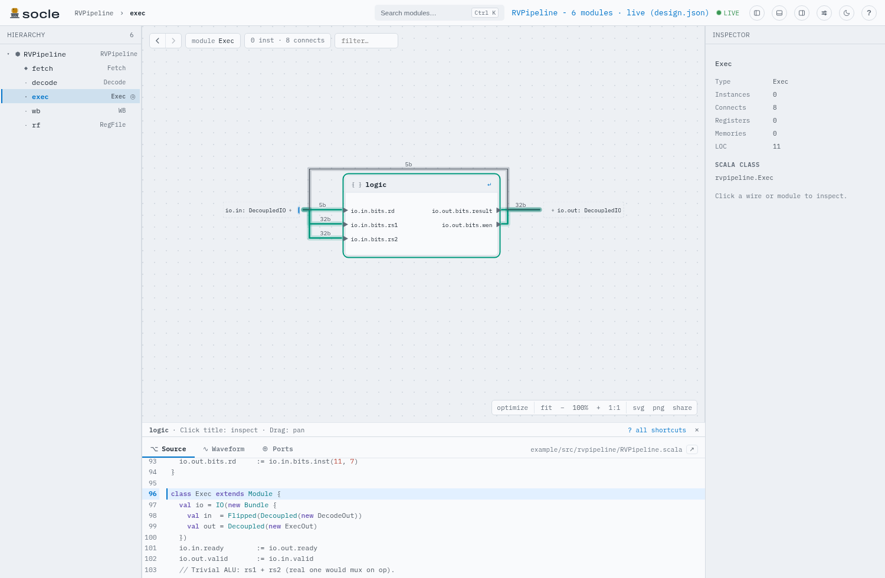

<h1>
  <picture>
    <source media="(prefers-color-scheme: dark)" srcset="brand/socle-logo-sombre.svg">
    
  </picture>
</h1>

*The socle for your Chisel designs.*

<p align="center">
<picture>
  <source media="(prefers-color-scheme: dark)" srcset="https://raw.githubusercontent.com/socless/socle/main/docs/media/hero-dark.gif">
  
</picture>
</p>

**An interactive UI for inspecting hardware designs.** Socle turns an
elaborated design into a navigable schematic, hierarchy, and inspector so a
hardware designer gets quick visual feedback on what their code actually built:
the module tree, the wires between instances, the intra-module logic (muxes,
adders, registers, memories), bundle structure, widths, and the source behind
each block.

Today it reads **Chisel / CHIRRTL**. The viewer is a single, self-contained HTML
file with no network dependencies, so a design is something you can open, share,
and explore offline.

There are three ways in, all front doors to the same UI:

- **Standalone app** - point the bundled, Python-free server at any `.fir`
  (CHIRRTL) or `design.json`, from any build that can emit CHIRRTL (sbt, mill,
  raw Chisel, ...). See **[docs/usage-standalone.md](docs/usage-standalone.md)**.
- **Mill plugin** - the smoothest Chisel integration: one task elaborates your
  design and serves the UI. See **[docs/usage-mill.md](docs/usage-mill.md)**.
- **Chisel IDE** - in a Mill project, a **View design** lens on every ChiselSim
  test shows the design that test elaborates in a live panel beside your code
  (no simulator needed, refreshed on save), and a **Simulate** lens runs the
  test with waves and opens them in [Surfer](https://surfer-project.org/). Use
  the VS Code extension ([docs/ide-vscode.md](docs/ide-vscode.md)), the IntelliJ IDEA plugin
  ([docs/ide-intellij.md](docs/ide-intellij.md)) or the
  language server in Neovim or any LSP editor
  ([docs/ide-neovim.md](docs/ide-neovim.md); in Neovim, the
  [socle.nvim](https://github.com/socless/socle.nvim) plugin sets it up).
  Your tests are never modified.

However you open it, [docs/usage-ui.md](docs/usage-ui.md) shows how to move
around the schematic (mouse, keyboard, history, following a net) and what the
waveform colours mean.

## Features

- **Navigate** the hierarchy tree or the schematic; double-click a box to drill
  into a submodule and breadcrumb back out (pan/zoom preserved per level).
- **Intra-module logic** as first-class nodes: muxes, primops/ALUs, registers,
  constants, FSMs, and memories are drawn and routed, not hidden.
- **Expand bundle ports** in place to see channels and fields; wires stay
  orthogonal and boxes move aside so nothing overlaps.
- **IDE view** of a ChiselSim test: logic grouped into FSM, generator-loop and
  `logic` blocks (a click opens the code), an FSM block opens into its state
  diagram with Scala conditions on the transitions, generator copies
  (`Seq.fill(n)(Module(...))`) fold into one box, and tied-off ports show
  their constant as a small stub.
- **Inspect** any wire or module (types, widths, registers/memories, source
  location) and **jump to the source** in your editor (VS Code / IntelliJ).
- **Command palette** (Ctrl/Cmd-K): fuzzy search over modules, instances, and
  pins, plus actions (theme, panels, optimize); `?` lists the mouse actions
  and keys ([docs/usage-ui.md](docs/usage-ui.md)).
- **Filter** the schematic with a live match count; a **sortable, filterable
  ports** table; a **Source** tab showing the Chisel behind each module.
- **Themes**: nine cohesive palettes (including an on-brand Blueprint) and a
  density control, in a settings panel.
- **Export**: SVG / PNG of the current schematic, or a self-contained **HTML
  snapshot** with the design embedded - send it to a colleague and they open it
  from `file://` with full interactivity, no repo or build needed.

## Quick start

Browse one of the bundled demos without publishing anything:

```bash
mill example.socleRun          # AXISystem (default); serves the UI
mill example.socleRunGcd       # GCD
mill example.socleRunPipeline  # 4-stage RISC-V pipeline
mill example.socleRunDeepSoc   # deep hierarchy
mill example.socleRunIoBundles # vec-of-bundle ports
mill example.socleRunRegHeavy  # register-heavy design
```

Then point it at your own design via the **[standalone
app](docs/usage-standalone.md)**, the **[Mill plugin](docs/usage-mill.md)** or
the **[Chisel IDE](docs/ide-vscode.md)**. Each release on the
[GitHub releases page](https://github.com/socless/socle/releases) attaches the
standalone jar, the language server jar and the single-file UI; the VS Code
extension and the IntelliJ plugin have their own releases
([VS Code](https://github.com/socless/socle-vscode/releases),
[IntelliJ](https://github.com/socless/socle-intellij/releases)).

<p align="center">
<picture>
  <source media="(prefers-color-scheme: dark)" srcset="https://raw.githubusercontent.com/socless/socle/main/docs/media/schematic-dark.png">
  
</picture>
<picture>
  <source media="(prefers-color-scheme: dark)" srcset="https://raw.githubusercontent.com/socless/socle/main/docs/media/fsm-dark.png">
  
</picture>
<picture>
  <source media="(prefers-color-scheme: dark)" srcset="https://raw.githubusercontent.com/socless/socle/main/docs/media/inspector-dark.png">
  
</picture>
</p>
<p align="center"><sub>A schematic with its source · a state machine's diagram · inside a module</sub></p>

## How it works

Chisel design -> `ChiselStage.emitCHIRRTL` -> CHIRRTL text -> typed AST -> bundle
dedup + wire coalescing + logic-node extraction -> `design.json` -> the Scala.js
UI. The exporter only uses Chisel's public CHIRRTL surface (no
`chisel3.internal.*`), so it survives Chisel patch updates. The Chisel IDE
captures the design a ChiselSim test elaborates with a Java agent instead, and
groups its logic with the help of your Scala sources. Details in
**[docs/how-it-works.md](docs/how-it-works.md)**; the per-file module map for
contributors is in [CLAUDE.md](CLAUDE.md).

## Roadmap

Socle is a hardware-inspection UI first; the Chisel/CHIRRTL exporter and the
Mill plugin are the first integrations. Planned directions:

- **Simulation frontend** - the first part has shipped: the Chisel IDE's
  Simulate lens runs a ChiselSim test and opens its waves in Surfer, which
  follows the schematic's selection. Still planned: an interactive panel to
  poke and step the design from the schematic (epic
  [#4](https://github.com/socless/socle/issues/4)).
- **CIRCT multi-level IR** - inspect a design across lowering passes, not just
  at the CHIRRTL level.
- **Exports & teamwork** - richer shareable artifacts and integrations for
  presentation and collaboration (the self-contained HTML snapshot is the first
  step).

## Contributing & releases

- Build, test, and dev-loop details: [CONTRIBUTING.md](CONTRIBUTING.md).
- What changed in each release: [CHANGELOG.md](CHANGELOG.md).
- Versioning and the release procedure: [RELEASING.md](RELEASING.md).
- Architecture and design decisions for contributors: [CLAUDE.md](CLAUDE.md).

## Licence

Socle is free software under the [GNU AGPL-3.0](LICENSE), with an additional permission for its
Eclipse (EPL) libraries; see [LICENSING.md](LICENSING.md). Anyone may use it, including at work.
Work that builds on Socle stays open source. Embedding Socle in a closed commercial tool needs a
commercial licence from the author. Bundled third-party software keeps its own licences
([THIRD_PARTY_NOTICES.md](THIRD_PARTY_NOTICES.md)).
